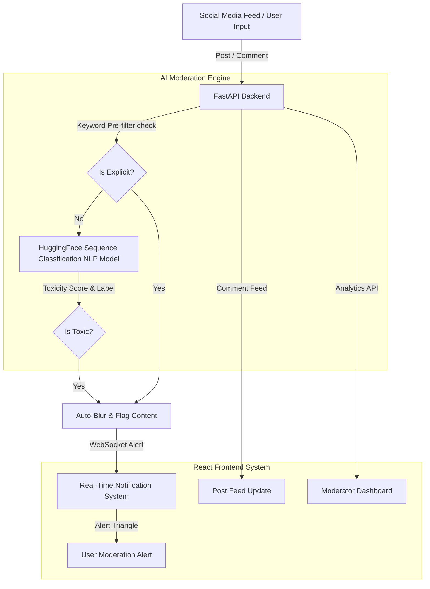
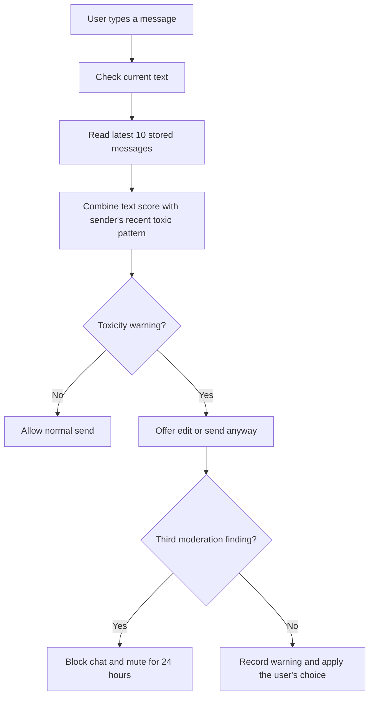

# Socialite: AI Cyberbully & Toxic Comment Detector

End-to-end safety analytics: **User Comments → Sequence Classification NLP Model → Real-Time WebSockets → FastAPI Backend → Live React Dashboard**.

## Architecture



### Chat Message Context-Aware Moderation Flow



## Premium Application Features

1. **Live intervention**: A debounced check runs while a user writes a post, comment, or chat message. The review dialog offers Cancel, Edit, and Post Anyway.
2. **Reasons and wording**: The dialog shows the model's overall toxicity score, phrase-match signals for insult/harassment/threat, and the matched wording when available.
3. **Repeat-offender handling**: Server-confirmed moderation findings count across posts, comments, and chat. The third finding triggers a 24-hour posting mute.
4. **Chat context**: Chat stores delivered messages and consults the latest 10 messages for repeated toxic behavior by the sender. Blocked attempts retain moderation metadata without storing their text.
5. **Image OCR**: Tesseract reads text in JPEG, PNG, and WEBP uploads before posting and the backend checks the image again during moderation.
6. **Voice check**: A selected voice note is transcribed, checked, then opened as editable text before sending as a chat message.

The bundled text model is binary (`non_offensive` / `toxic`). The insult, harassment, and threat percentages are transparent phrase-match indicators, not calibrated probabilities from a multi-label model. Exact causal word attribution is available only when a known phrase matched.

## Prerequisites

| Tool | Required Version | Check Command |
|------|-----------------|---------------|
| Python | 3.10+ | `python --version` |
| Node.js | 16+ | `node --version` |
| MongoDB | Running locally | `mongosh --eval "db.runCommand({ ping: 1 })"` |
| Git | Any | `git --version` |
| Tesseract OCR | Current | `tesseract --version` |

Voice transcription is optional and requires `GROQ_API_KEY` in `backend/.env`. Selecting a voice note sends that audio to Groq for transcription; the resulting text is checked locally and shown for review before it is sent as a chat message.

## Starting MongoDB (MongoDB Desktop)

If you have **MongoDB Desktop** installed:

1. Open **MongoDB Desktop**
2. Go to the **Services** tab (or **My Cluster**)
3. Click **Start** next to your local MongoDB instance
4. Wait for the status to show **Running** (green)

Alternatively, start it from PowerShell:

```powershell
net start MongoDB
```

Confirm it is running:

```powershell
mongosh --eval "db.runCommand({ ping: 1 })"
# Expected output: { ok: 1 }
```

## Quick Start

```bash
# 1. Clone and enter the project
git clone https://github.com/astha1504/Cyberbully-and-toxic-comment-detector.git
cd Cyberbully-and-toxic-comment-detector

# 2. Create and activate Python virtual environment
cd backend
python -m venv venv
# Windows:
venv\Scripts\activate
# macOS/Linux:
source venv/bin/activate

# 3. Install backend dependencies
pip install -r requirements.txt

# 4. Start the FastAPI backend
uvicorn app.main:app --reload --port 8000

# 5. In a new terminal, install frontend dependencies and start dev server
cd ../frontend
npm install
npm run dev

# 6. Access the Local App
# Open http://localhost:5173
```

- **API docs**: http://localhost:8000/docs  
- **App Dashboard**: http://localhost:5173


## Running the Toxicity Moderation Engine

Place your PyTorch/Safetensors moderation weights under `backend/model/`. If the model cannot load, explicit phrase matches still work and the app marks other checks as unverified instead of claiming the text is safe. Image OCR uses the Tesseract executable on `PATH`; set `TESSERACT_CMD` in `backend/.env` if it is installed elsewhere.

Note: `backend/model/` is gitignored because model weights are large files. After cloning, add your trained model files to that directory manually.

## API Endpoints

| Method | Path | Description |
|--------|------|-------------|
| `POST` | `/comments/` | Creates a comment & Triggers Background ML Toxicity Task |
| `POST` | `/api/moderation/check-text` | Checks text while composing and returns score, phrase signals, and matched wording |
| `POST` | `/api/moderation/check-image` | OCRs a base64 image data URI and checks the detected text |
| `POST` | `/api/moderation/check-audio` | Sends an uploaded audio file to configured Groq transcription, then checks the transcript |
| `POST` | `/chat/conversation` | Creates a conversation between two users |
| `GET` | `/chat/conversations` | Retrieves user's conversation list |
| `GET` | `/chat/messages/{conv_id}` | Retrieves messages for a conversation |
| `WS` | `/ws/notifications` | WebSocket for real-time messaging and chat moderation |
| `PATCH`| `/notifications/read-all` | Marks all moderation socket alerts as Read |
| `POST` | `/posts/{id}/like` | Updates user interaction & handles post engagement |
| `GET`  | `/posts/` | Feed data query with hydrated authors and comments count |
| `GET`  | `/analytics/toxic-comments` | Chart metrics representing weekly flagged content trends |
| `GET`  | `/notifications/` | Real-time fetch of user's personal alerts |

### Chat Toxicity Warning Payload

```json
{
  "type": "toxicity_warning",
  "message": "Harassment detected. This behavior violates community guidelines.",
  "original_content": "offensive message text",
  "toxicity_score": 0.92,
  "label": "suppression_pattern",
  "highlighted_words": ["worthless"],
  "category_scores": {"insult": 100, "harassment": 100, "threat": 0},
  "context": {
    "is_friend": false,
    "conversation_toxicity": 0.7,
    "recent_messages_considered": 10,
    "toxic_messages_from_sender": 7
  }
}
```

## Moderation payload Schema

```json
{
  "_id": "647f123abc456",
  "post_id": "65b9c1d...",
  "user_id": "673cf82...",
  "content": "This is a hateful comment",
  "moderation_status": "flagged",
  "is_blurred": true,
  "is_toxic": true,
  "toxicity_score": 0.98,
  "created_at": "2026-06-19T14:22:10Z"
}
```

## Context-Aware Moderation Logic

The chat checker considers the current message and the latest 10 stored messages in that conversation. It adds a context signal when the same sender has recent toxic messages, and surfaces that pattern in the moderation warning. Friendship does not lower the toxicity threshold.

## Live WebSockets & Moderation Demo 

The frontend implements a robust WebSocket connection. To watch your comments get detected and flagged live:

```bash
# Terminal 1 — start API
cd backend && uvicorn app.main:app --port 8000

# Terminal 2 — start dashboard
cd frontend && npm run dev
```

Open http://localhost:5173, log into your profile, and test posting an abusive keyword. Watch the **🔴 Moderation Warning** slide in dynamically through your notification system, instantly blurring the text on the public feed!

## Tests

```bash
cd backend
pytest tests/ -v
pytest tests/ --cov=app --cov-report=term-missing
```

Covers: ML pipeline fallback testing, background task integration, WebSocket payloads, toxicity keyword exact matching, and missing field validation.

## Data Structure (read-only)

| Path | Contents |
|------|----------|
| `backend/model/*.safetensors` | Neural Network Weights |
| `backend/model/config.json` | Tokenizer configuration and `id2label` mapping |
| `backend/app/services/moderation_service.py` | Asynchronous ML inference, keyword filtering, and context-aware chat moderation |
| `backend/app/database.py` | MongoDB connection & collections instance |
| `backend/fix_data.py` | Custom Faker script resolving ID constraints |
| `backend/app/routes/websockets.py` | WebSocket handlers with integrated toxicity moderation |

**Never modify raw tensors under `backend/model/`.**

## Edge Cases Handled

| Edge Case | How We Handle It |
|-----------|-----------------|
| ML Model Missing/Loading | Automatically falls back to keyword-based filtering + sets safety flags while PyTorch loads into memory |
| Socket Disconnects | React `useSocket` reconnects. Missed alerts are re-polled via standard HTTP GET `/notifications/` |
| Invalid Comment Data | Schema validation catches missing text/empty strings before it ever hits the HuggingFace Transformer |
| UI Empty States | Empty suggestions/notifications render bespoke empty-state "Zero items" mockups gracefully |
| Null Relational Data | Custom script (`fix_data`) injects strict `ObjectId` mapping to prevent `Unknown` user rendering |
| Toxic Chat Message | Blocked before delivery. Sender receives warning notification instead. |
| Friend vs Stranger Context | Different toxicity thresholds applied based on relationship status. |
| Conversation Suppression Patterns | Repeated toxicity triggers bullying/suppression detection. |

See [CHOICES.md](CHOICES.md) for architecture and decision rationale.
